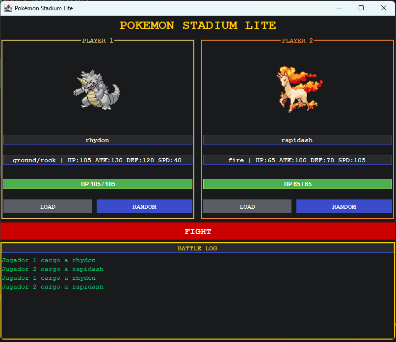
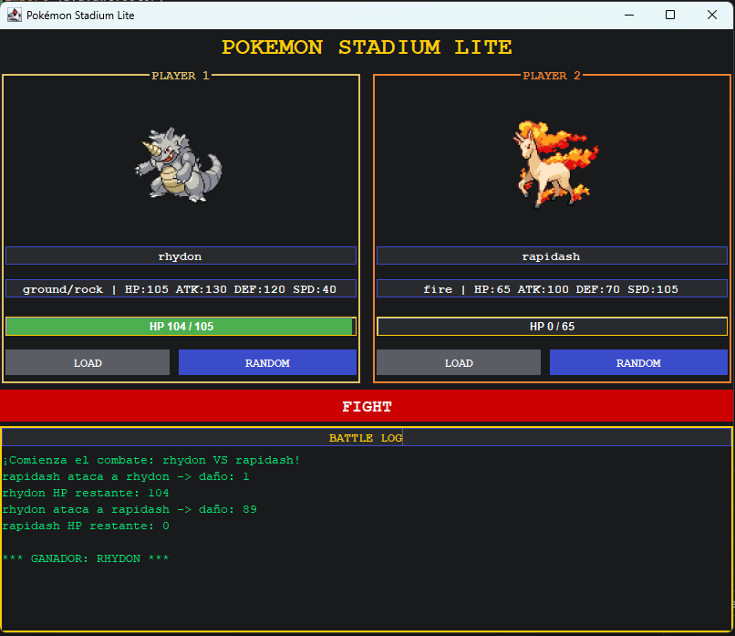
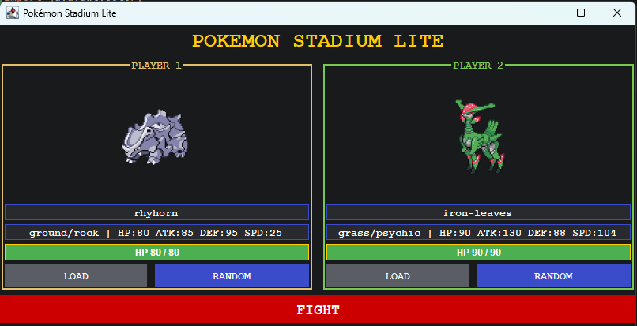
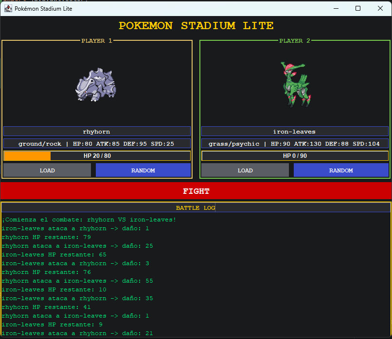

# Pokémon Stadium Lite

Codigos y nombres:

Julian Andres Rojas Palacio 2459687-3743
Juan Manuel Perez Cruz 2266033-3743

Mini-aplicación de escritorio en **Java Swing** que simula un combate por turnos entre dos Pokémon obtenidos en vivo desde [PokeAPI](https://pokeapi.co/).

Materia: Desarrollo de Software III, Universidad del Valle, Sede Tuluá.

## Instrucciones de ejecución

1. Tener instalado **Java 11 o superior**.
2. Abrir el proyecto en IntelliJ IDEA.
3. Verificar que la librería `lib/json-20230227.jar` (`org.json`) esté agregada al proyecto: clic derecho sobre el jar > *Add as Library...*
4. Ejecutar la clase `Main`.
5. En cada lado, cargar un Pokémon:
   - **RANDOM**: Pokémon aleatorio.
   - **LOAD**: escribir el nombre en el campo (por ejemplo `pikachu`) y pulsar el botón.
6. Cuando ambos estén cargados se habilita **FIGHT!** y comienza el combate.

Se necesita conexión a internet (consulta la API y descarga los sprites).

## Estructura del proyecto

| Paquete | Clase | Responsabilidad |
|---|---|---|
| `API` | `PokeApiClient` | Consulta PokeAPI con `HttpClient` y convierte el JSON en un `Card` |
| `Model` | `Card` | Modelo del Pokémon: nombre, tipos, stats, sprite y HP actual |
| `Logic` | `Duel` | Reglas del combate por turnos |
| `Logic` | `BattleListener` | Interfaz que desacopla la lógica de la UI |
| `UI` | `Stadium` | Interfaz Swing (`Stadium.form`) |
| (raíz) | `Main` | Punto de entrada |

## Diseño

La aplicación separa la interfaz de la lógica de negocio. `Duel` no conoce ningún componente Swing: solo notifica lo que ocurre mediante `BattleListener` (`onTurn`, `onHpChanged` y `onBattleEnded`), y `Stadium` implementa esa interfaz, de modo que la UI se actualiza únicamente a partir de esos eventos.

Las consultas a la API, la descarga de imágenes y el combate se ejecutan en hilos aparte para no bloquear la interfaz, y toda actualización de componentes se hace con `SwingUtilities.invokeLater`. Los errores (Pokémon no encontrado o falla de red) se muestran en un diálogo y en el log de batalla.

## Reglas del combate

- **Orden:** inicia el de mayor *Speed*; si hay empate, es aleatorio. Luego se alternan los turnos.
- **Daño:** `daño = ATK * random(0-1) - (DEF * 0.5) * random(0-1)`, con mínimo de 1. La defensa pesa la mitad para que los combates no se alarguen.
- **Crítico:** 10 % de probabilidad, multiplicador x1.5.
- **Efectividad** (según el primer tipo): Agua > Fuego, Fuego > Planta y Planta > Agua (x1.3); lo inverso x0.7; el resto x1.0.
- El HP nunca baja de 0 y el combate termina cuando uno llega a 0.

## Capturas de pantalla

### Pokémon cargados 1

### Combate finalizado 1

### Pokémon cargados 2

### Combate finalizado 2

